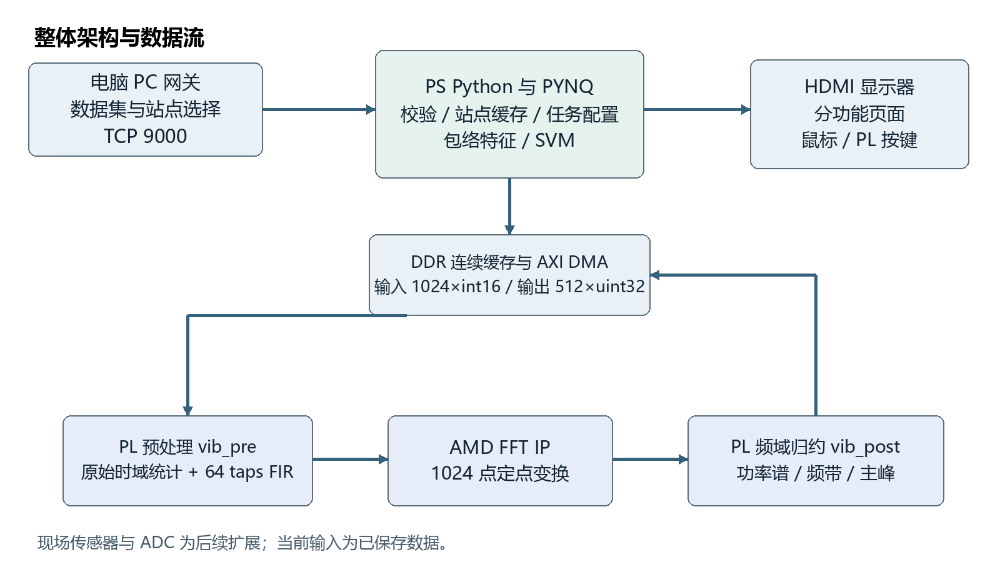

# AMD FPGA and PYNQ Multi-channel Vibration Analysis

基于 AMD Zynq-7020 / ALINX AX7020 的三通道振动分析与故障诊断项目。
PC 是数据配置与传输网关；分析和主要显示在板端完成，HDMI 直连显示器。



## Implemented pipeline

PC stored recordings → TCP 9000 / VIB1 → per-site frame cache → DMA →
64-tap Q1.15 FIR → 1024-point FFT → PL feature reduction → PS envelope features
and 39-dimensional RBF SVM → local HDMI pages and JSON export.

Three channels time-share one PL chain. This is not three independent FFT engines.
The eight local pages separately demonstrate input, FIR, FFT, features, diagnosis,
evaluation, performance and configuration. Mouse and board buttons control pages,
pause/resume and cached-frame inspection.

## Recorded results

- Complete test: 2132 frames, 262 source-bounded groups of eight; one group misclassified.
- PL and PS classifications agree for all 262 groups; agreement is not ground-truth accuracy.
- 600 s paced DDR recording test: 1758 groups, zero deadline misses and zero queue backlog.
- FPGA: 14352 LUT, 20764 FF, 94 DSP, 8 BRAM; 100 MHz, WNS +0.453 ns.
- Full evidence and test scope are retained under evidence/qualification_corrected_20261023.

## Reproduce software

Use Python 3.10 or a compatible PC environment:

```sh
python -m pip install -r training/requirements.txt
python training/fetch_raw.py --out raw
python training/reproduce.py --raw-dir raw --out rebuilt_training
```

Raw CWRU recordings are downloaded from their original host and checked against
data/raw_manifest.json. No raw recordings or derived NPZ dataset are republished here.
Read the training script's output paths and place the produced dataset/model files
at the project root before running the board console or PC GUI. The default dataset
is dataset_test_3ch.npz, with 262 source-bounded evaluation groups.

```sh
python pc_gateway_gui.py
python -m unittest discover -s tests -p test_gateway_protocol.py -v
```

The complete offline suite additionally needs the regenerated dataset and
training/group_features.npz. Run full tests only after reproducing these fixtures.
Board inference requires a compatible PYNQ image and a valid Overlay; see hardware/README.md.

## Repository and judging archive

This public tree contains project-authored processing software, original vibration
HLS sources, tests, model parameters and numeric evidence. The competition RAR
additionally contains the validated Overlay, Vivado build project, board presets,
generated/third-party IP, datasets and the technical report for judge reproduction.
Those assets are intentionally not republished under an assumed blanket license.
The signed authorization, team details, private account paths, recordings of the
team and full private chat history are not included in this repository.

## Scope

Current inputs are stored recordings and PC playback. No physical ADC or online
sensor producer has been validated. Normal BA is derived from DE; rotor imbalance
is synthetic. Bearing defects come from CWRU artificial-defect experiments.
These results do not establish natural early-degradation or cross-machine performance.
OVO votes are classification evidence, not calibrated fault probabilities.

## License and attribution

Project-authored code is provided under the MIT license in license.md, subject to the
explicit exclusions and third-party attributions in third_party_notices.md.
AMD/Xilinx tools, generated IP, PYNQ, board vendor resources and CWRU data retain
their respective owners' licenses; this repository does not relicense them.


## AMD directory mapping and judging package

The recommended AMD layout is mapped here to preserve the working software paths.

| Recommended directory | Public tree | Additional files in the judging RAR |
|---|---|---|
| src/ | Root Python, hardware/hls/ | Video adapters, Vivado source and vendor resources |
| sim/ | tests/, HLS test benches | Recording fixtures and HLS run logs |
| build/ | hardware/README.md | hardware/build.py, Vivado Tcl, IP and implementation reports |
| board/ | Driver, validation and qualification scripts | bit/hwh/tcl, deployment/ and board results |
| data/ | Provenance, raw manifest, model and training scripts | Derived recordings and feature fixtures |
| skill/ | skill/ | Same workflows, comparison script and stated validation limits |
| report/ | docs/overview.md and numeric evidence | report/design_report.pdf, AI collaboration records, optimization and reproduction notes |

The competition RAR contains the engineering package, skill package and design report together. It is more complete than this deliberately limited public distribution. Private dialogue exports and third-party assets are not published here. General PYNQ reuse beyond the tested AX7020 remains unverified.
